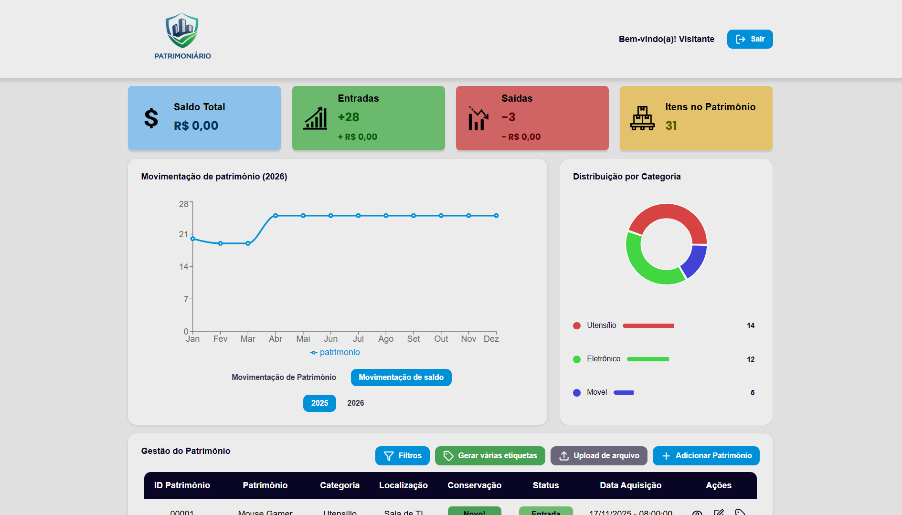
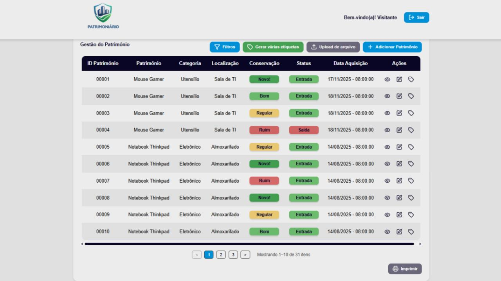
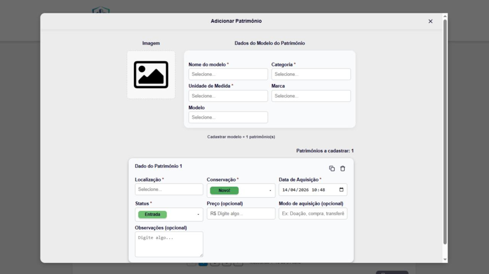
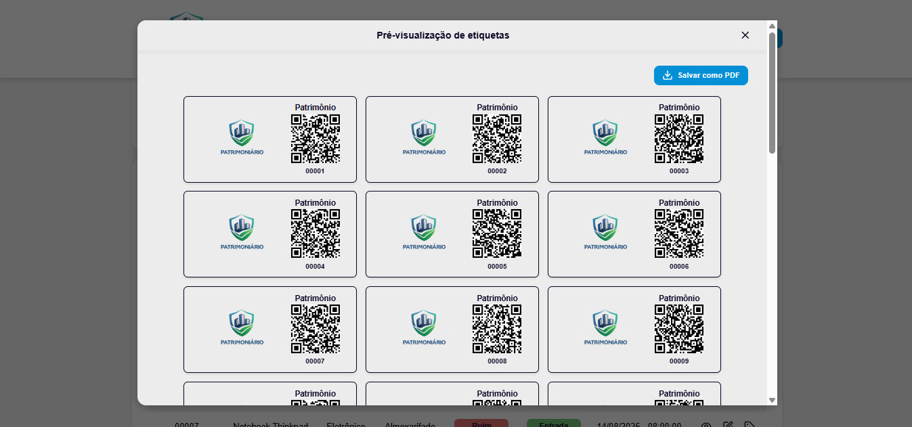
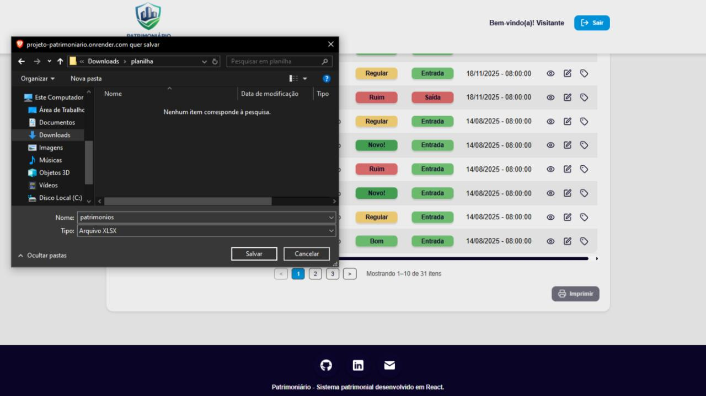
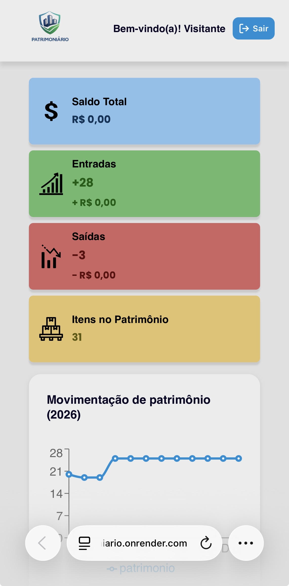
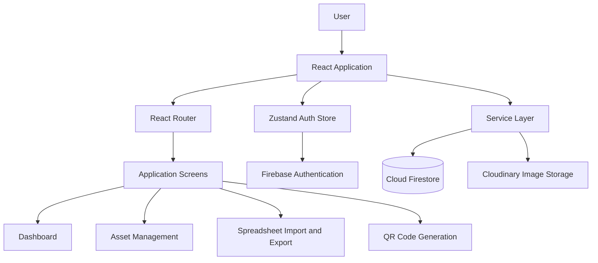
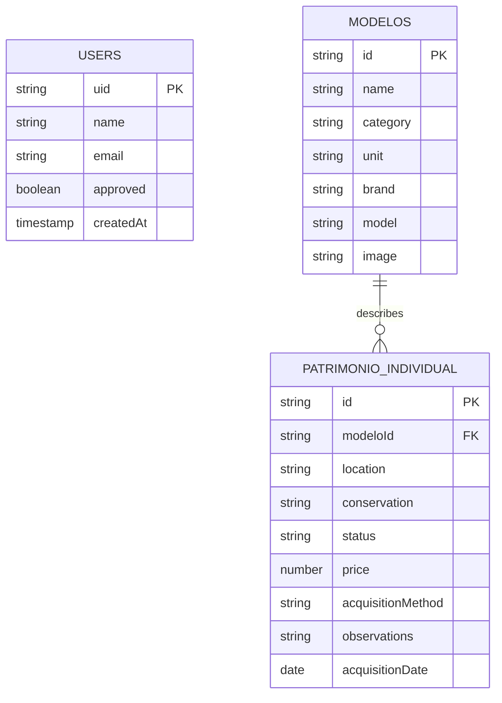
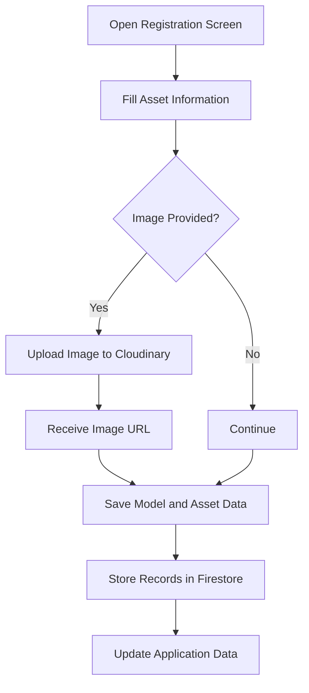
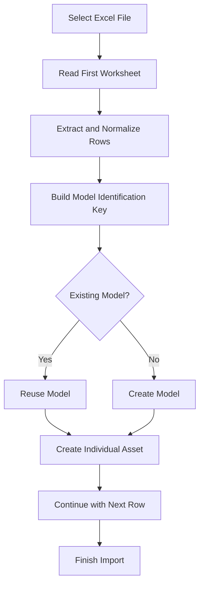

<p align="center">
  <a href="README.md"></a>
  <a href="README.pt.md"></a>
</p>


<h1 align="center">🏢 Patrimoniário</h1>

<p align="center">
An asset management system designed to centralize, organize, and simplify institutional asset management.
</p>

<p align="center">
  
</p>

<p align="center">
  
  
  
  
  
  
  
  
  
  
  
</p>

<p align="center">
  <a href="https://projeto-patrimoniario.onrender.com/" target="_blank">
    
  </a>
</p>

---

## 📌 Project Overview

Patrimoniário is a web application developed to improve how institutions register, organize, and manage their physical assets.

The project was created to replace spreadsheet-based workflows with a centralized system, making asset information easier to access, update, and maintain.

The application provides individual asset registration, spreadsheet import and export, image management, QR Code identification, and a dashboard with relevant management indicators.

The system was built using React, TypeScript, Firebase, and Cloudinary, with a focus on usability, maintainability, and practical problem-solving.

## 🎯 The Problem

Before the system was developed, asset information was maintained through spreadsheets.

This approach created some operational challenges:

- Asset information was distributed across spreadsheets.
- Updating and locating records could become repetitive.
- Registering assets individually was time-consuming.
- Identifying physical assets required a more organized process.
- Visualizing asset distribution and acquisition information was less practical.

The goal was to create a centralized solution that could simplify these activities without making the workflow unnecessarily complex.

## 💡 The Solution

Patrimoniário provides a web-based environment where users can register, organize, identify, and manage institutional assets.

One of the main decisions was to support spreadsheet-based bulk registration. Instead of requiring every asset to be entered individually, the import workflow allows users to prepare structured data and register multiple assets through a single operation.

The application also separates reusable asset descriptions from individual physical asset records, reducing repeated information and improving data organization.

## ✨ Core Features

### Asset Management
- Register, edit, view, and delete individual assets.
- Organize assets by category, location, conservation condition, and status.
- Store acquisition information, prices, and observations.
- Reuse descriptive models across multiple physical assets.

### Dashboard and Data Visualization
- Display total asset records.
- Summarize asset entries and exits.
- Calculate total asset values.
- Present category distribution and monthly movement indicators.
- Visualize information through charts using Recharts.

### Spreadsheet Import and Export
- Import multiple assets from Excel spreadsheets.
- Process structured spreadsheet data.
- Reuse existing asset models when possible.
- Export filtered asset records to Excel.

### QR Code Identification
- Generate QR Codes for individual assets.
- Link each QR Code to the corresponding asset details page.
- Support faster identification and access to asset information.

### Image Management
- Upload asset images using Cloudinary.
- Store image URLs alongside asset records.
- Display images in asset registration and management screens.

### Authentication and Protected Routes
- User registration and login through Firebase Authentication.
- Check user approval status before granting access.
- Protect application routes from unauthenticated access.

---

## 🖥️ System Preview

<div align="center">

| Dashboard | Asset Management |
|-----------|--------------------|
| <p align="center"></p> | <p align="center"></p> |

| Add Asset | Smart Labels |
|----------------------|------------------------|
| <p align="center"></p> | <p align="center"></p> |

| Bulk Import | Mobile Version |
|---------------------|---------------|
| <p align="center"></p> | <p align="center"></p> |
  
</div>

---

## 🏗️ System Architecture

The application follows a frontend-focused architecture using Firebase as its Backend-as-a-Service (BaaS).

React handles the user interface and application logic, while Firebase provides authentication and database services. Cloudinary is responsible for image storage.



### Application Layers

| Layer | Responsibility |
|---|---|
| Presentation | React components and application screens |
| Routing | Navigation and protected routes |
| State Management | Authentication state through Zustand |
| Services | Business operations and communication with external services |
| Authentication | Firebase Authentication |
| Database | Cloud Firestore |
| Image Storage | Cloudinary |

The service layer centralizes operations involving authentication, asset records, reusable models, and image uploads, keeping these responsibilities separate from the presentation components.

## 🧩 Database Design

The application uses Cloud Firestore, a NoSQL document database.

The main collections are:

### Users

Stores user information and access approval status.

| Field | Description |
|---|---|
| uid | Firebase Authentication user identifier |
| name | User name |
| email | User email |
| approved | Indicates whether the user is authorized to access the application |
| createdAt | Registration timestamp |

### Modelos

Stores reusable descriptive information about asset types.

| Field | Description |
|---|---|
| id | Model identifier |
| name | Asset name |
| category | Asset category |
| unit | Measurement unit |
| brand | Manufacturer or brand |
| model | Model description |
| image | Associated image URL |
| creator | User who created the record |
| timestamps | Creation and update information |

### PatrimonioIndividual

Stores information about each physical asset.

| Field | Description |
|---|---|
| id | Asset identifier |
| modeloId | Reference to the associated model |
| location | Asset location |
| conservation | Conservation condition |
| status | Current asset status |
| price | Asset value |
| acquisitionMethod | Acquisition method |
| observations | Additional information |
| inventoryKeeper | Person responsible for inventory |
| acquisitionDate | Acquisition date |
| updateDate | Last update date |

### Logical Relationship



The relationship between `modelos` and `patrimonioIndividual` is logical and maintained through `modeloId`. Firestore does not enforce relational foreign keys.

---

## ⚙️ Technical Decisions and Challenges

### 1. Separating Asset Models from Individual Records

One important design decision was to separate reusable descriptive information from individual physical assets.

For example, multiple physical items can share the same name, category, brand, and model while having different locations, conservation conditions, and acquisition information.

This avoids unnecessary duplication and makes bulk registration more practical.

### 2. Spreadsheet Import Strategy

Spreadsheet import was designed to support the existing workflow instead of forcing users to register assets individually.

The import process:

1. Reads the first worksheet of the Excel file.
2. Extracts and normalizes the relevant fields.
3. Builds a key from descriptive asset information.
4. Checks whether a corresponding model already exists.
5. Reuses an existing model or creates a new one.
6. Creates individual asset records based on the imported rows.

This approach helps maintain consistency between reusable models and individual asset records.

### 3. Image Storage with Cloudinary

Image storage was initially considered through a different backend service, but the implementation was moved to Cloudinary.

The application uploads images to Cloudinary and stores the returned secure URL in Firestore.

This keeps image files separate from the database records.

### 4. Authentication and Access Approval

User authentication is handled by Firebase Authentication.

In addition to verifying credentials, the application checks the user's approval status in Firestore.

Newly registered users are assigned `approved: false`. The login flow rejects users who have not been approved.

This provides an additional access-control step beyond authentication alone.

### 5. State Management

Zustand manages the authentication state across the application.

Firebase authentication state changes are observed through `onAuthStateChanged`, allowing the application to synchronize the current user state with the authentication service.

---

## 🔄 Asset Management Workflows

### Individual Asset Registration



### Spreadsheet Import



The import workflow processes spreadsheet rows individually. It does not currently implement an atomic transaction or automatic rollback for the entire import operation.

---

## ☁️ Firebase and Cloud Services

### Firebase Authentication

Used for:
- User registration.
- User login.
- Authentication state monitoring.
- Authentication-based route protection.

### Cloud Firestore

Used to store:
- User information and approval status.
- Reusable asset models.
- Individual asset records.

### Cloudinary

Used for:
- Uploading asset images.
- Hosting image files.
- Providing secure image URLs used by the application.

---

## 🛠️ Technology Stack

| Category | Technologies |
|---|---|
| Frontend | React 19, TypeScript |
| Build Tool | Vite |
| Styling | Styled Components |
| Routing | React Router |
| State Management | Zustand |
| Authentication | Firebase Authentication |
| Database | Cloud Firestore |
| Image Storage | Cloudinary |
| Data Processing | ExcelJS, XLSX |
| QR Codes | qrcode.react |
| PDF Generation | jsPDF, html2canvas |
| Charts | Recharts |
| Notifications | React Toastify |
| Icons | Lucide React |
| Testing | Jest, React Testing Library |
| Code Quality | ESLint |
| Deployment | Render |

---

## 🧪 Testing and Code Coverage

The project includes an initial testing setup using Jest and React Testing Library.

The existing tests cover selected service and utility functions, including:

- Authentication and user approval validation.
- Asset service operations.
- Initial Firestore data retrieval.
- Data validation and normalization.
- Date formatting.
- Currency formatting and parsing.
- Price-related utility functions.

### Coverage Snapshot

The following figures come from the coverage report included in the project archive. They represent an initial testing stage, not a comprehensive test suite.

| Metric | Coverage |
|---|---:|
| Statements | 31.02% |
| Branches | 19.59% |
| Functions | 27.50% |
| Lines | 31.00% |

Testing was started to validate important application operations, but the suite was not fully expanded.

---

## 🚀 CI/CD and Deployment

The project includes scripts for development, production builds, linting, and testing.

Available commands:

```bash
npm run dev
npm run build
npm run lint
npm test
npm run test:coverage
```

The project has been deployed using Render.

A GitHub Actions or Jenkins CI/CD pipeline was not configured in the repository snapshot used for this documentation.

---

## ⚠️ Limitations and Future Improvements

Some improvements identified for future development include:

- Expand unit and integration test coverage.
- Implement automated CI/CD workflows.
- Improve error handling during spreadsheet imports.
- Add transaction or rollback strategies for bulk operations.
- Implement image deletion through the Cloudinary API.
- Improve validation and feedback during data registration.
- Review and strengthen Firestore security rules.
- Improve documentation and environment configuration.
- Expand the asset management dashboard and reporting capabilities.

These improvements represent opportunities to make the application more robust, maintainable, and suitable for larger datasets and more complex workflows.

---

## 📚 Key Technical Learnings

Developing Patrimoniário provided practical experience in:

- Building a complete React and TypeScript application.
- Structuring frontend services and separating application responsibilities.
- Integrating Firebase Authentication and Cloud Firestore.
- Modeling relationships in a NoSQL database.
- Managing authentication state with Zustand.
- Processing and importing structured Excel data.
- Integrating external image storage with Cloudinary.
- Generating QR Codes and PDF documents.
- Building dashboards and data visualizations.
- Writing unit tests with Jest and React Testing Library.
- Identifying architectural limitations and opportunities for improvement.

The project also reinforced the importance of understanding the real operational workflow before choosing technical solutions.

---

## 💻 Getting Started

### Prerequisites

- Node.js
- npm
- Firebase project
- Cloudinary account

### 1. Clone the Repository

```bash
git clone https://github.com/matheusconaga/projeto_patrimoniario.git

cd projeto_patrimoniario
```

### 2. Install Dependencies

```bash
npm install
```

### 3. Configure Environment Variables

Create a `.env` file in the project root:

```env
VITE_FIREBASE_API_KEY=your_firebase_api_key
VITE_FIREBASE_AUTH_DOMAIN=your_firebase_auth_domain
VITE_FIREBASE_PROJECT_ID=your_firebase_project_id
VITE_FIREBASE_STORAGE_BUCKET=your_firebase_storage_bucket
VITE_FIREBASE_MESSAGING_SENDER_ID=your_firebase_messaging_sender_id
VITE_FIREBASE_APP_ID=your_firebase_app_id

VITE_CLOUDINARY_CLOUD_NAME=your_cloudinary_cloud_name
VITE_CLOUDINARY_UPLOAD_PRESET=your_cloudinary_upload_preset
```

Replace the placeholder values with your own Firebase and Cloudinary configuration.

### 4. Run the Development Server

```bash
npm run dev
```

The application will be available at the local address provided by Vite.

### 5. Build for Production

```bash
npm run build
```

---

## 📄 License

No formal open-source license is currently provided in this repository.

For usage or distribution permissions, please contact the author.

---

## 👨‍💻 About the Developer

<p align="center">
  
</p>

<h3 align="center">Matheus Lula</h3>

<p align="center"><strong>Software Engineer • Python • FastAPI • TypeScript • Node.js • PostgreSQL</strong>

</p>

I develop web applications, backend services and API integrations, with an interest in software architecture, automation and AI-powered solutions.

Patrimoniário is an asset management system designed to replace spreadsheet-based workflows with a centralized platform for registering, organizing and identifying institutional assets. This project explores the application of modern frontend technologies, cloud services and data management practices to solve a practical organizational problem, with features such as bulk Excel import, QR Code generation, dashboards and image management.


<p align="center">
<a href="mailto:matheusphillip170@gmail.com"></a>
<a href="https://www.linkedin.com/in/matheusconaga/"></a>
  <a href="https://matheusconaga.dev/">
    
  </a>