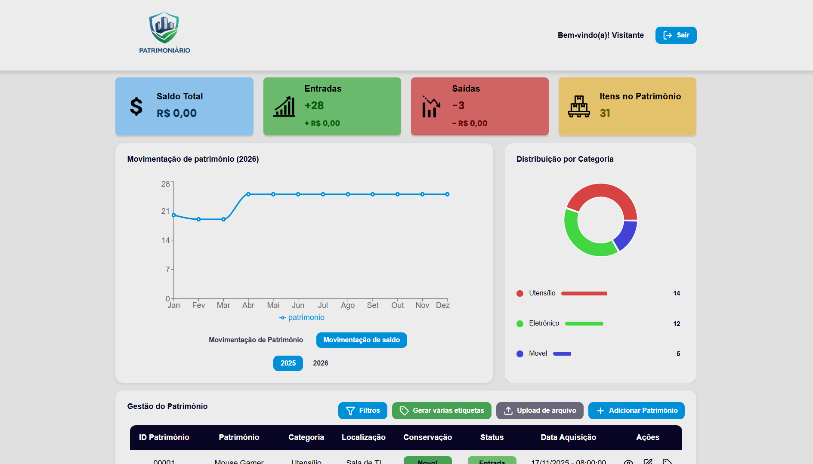
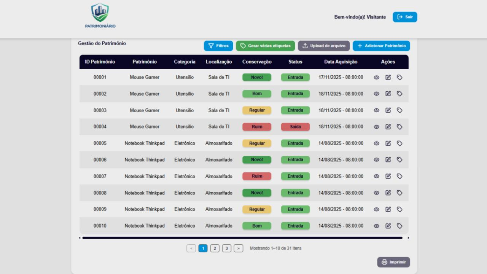
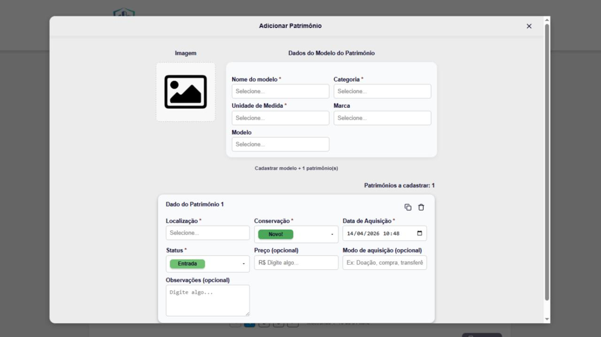
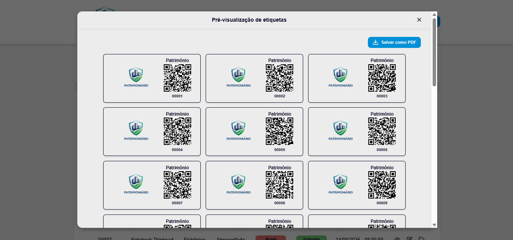
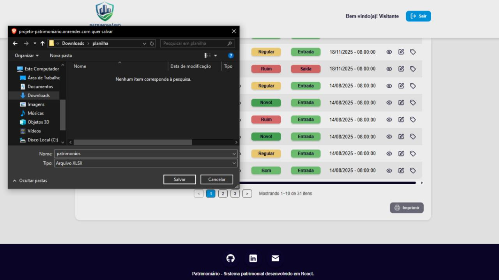
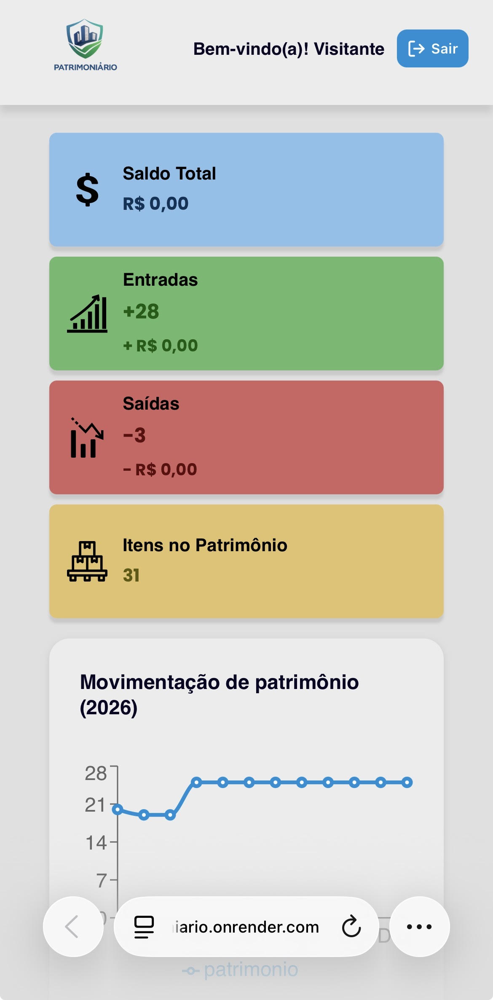
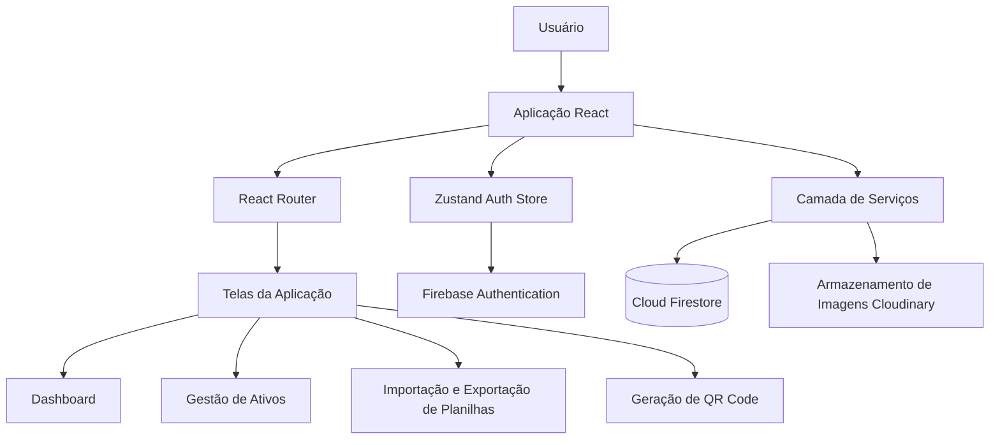
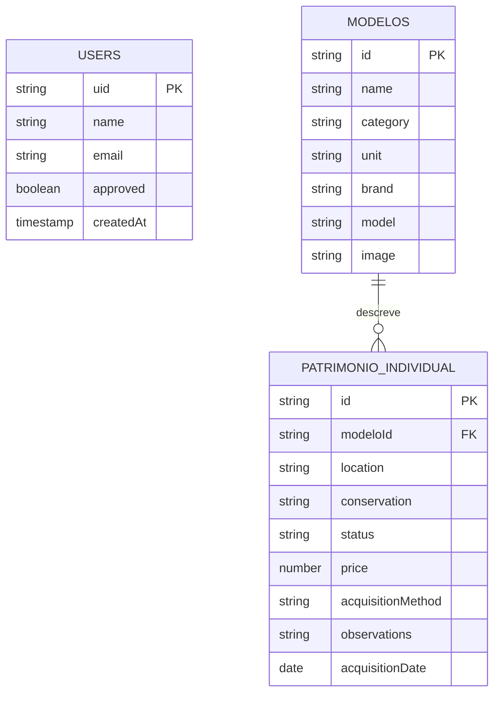
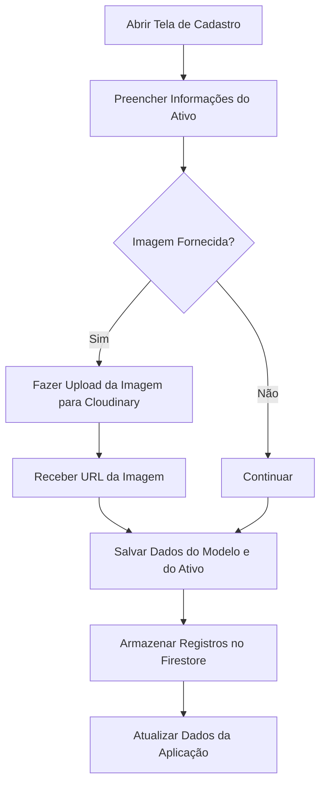
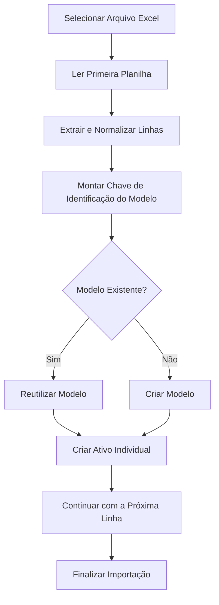

<p align="center">
  <a href="README.md"></a>
  <a href="README.pt.md"></a>
</p>


<h1 align="center">🏢 Patrimoniário</h1>

<p align="center">
Um sistema de gestão patrimonial projetado para centralizar, organizar e simplificar o gerenciamento de ativos institucionais.
</p>

<p align="center">
  
</p>

<p align="center">
  
  
  
  
  
  
  
  
  
  
  
</p>

<p align="center">
  <a href="https://projeto-patrimoniario.onrender.com/" target="_blank">
    
  </a>
</p>

---

## 📌 Visão Geral do Projeto

O Patrimoniário é uma aplicação web desenvolvida para melhorar como as instituições registram, organizam e gerenciam seus ativos físicos.

O projeto foi criado para substituir fluxos baseados em planilhas por um sistema centralizado, tornando as informações dos ativos mais fáceis de acessar, atualizar e manter.

A aplicação oferece cadastro individual de ativos, importação e exportação de planilhas, gerenciamento de imagens, identificação por QR Code e um dashboard com indicadores gerenciais relevantes.

O sistema foi construído usando React, TypeScript, Firebase e Cloudinary, com foco em usabilidade, manutenibilidade e resolução prática de problemas.

## 🎯 O Problema

Antes do desenvolvimento do sistema, as informações dos ativos eram mantidas por meio de planilhas.

Essa abordagem criava alguns desafios operacionais:

- As informações dos ativos ficavam distribuídas em planilhas.
- Atualizar e localizar registros podia se tornar repetitivo.
- Cadastrar ativos individualmente consumia bastante tempo.
- Identificar ativos físicos exigia um processo mais organizado.
- Visualizar a distribuição dos ativos e as informações de aquisição era menos prático.

O objetivo foi criar uma solução centralizada que pudesse simplificar essas atividades sem tornar o fluxo de trabalho desnecessariamente complexo.

## 💡 A Solução

O Patrimoniário fornece um ambiente web onde os usuários podem cadastrar, organizar, identificar e gerenciar ativos institucionais.

Uma das principais decisões foi suportar o cadastro em lote baseado em planilhas. Em vez de exigir que cada ativo seja inserido individualmente, o fluxo de importação permite que os usuários preparem dados estruturados e cadastrem vários ativos em uma única operação.

A aplicação também separa descrições reutilizáveis de ativos dos registros individuais de ativos físicos, reduzindo informações repetidas e melhorando a organização dos dados.

## ✨ Principais Funcionalidades

### Gestão de Ativos
- Cadastrar, editar, visualizar e excluir ativos individuais.
- Organizar ativos por categoria, localização, estado de conservação e status.
- Armazenar informações de aquisição, preços e observações.
- Reutilizar modelos descritivos em vários ativos físicos.

### Dashboard e Visualização de Dados
- Exibir o total de registros de ativos.
- Resumir entradas e saídas de ativos.
- Calcular o valor total dos ativos.
- Apresentar a distribuição por categoria e indicadores de movimentação mensal.
- Visualizar informações por meio de gráficos usando Recharts.

### Importação e Exportação de Planilhas
- Importar vários ativos a partir de planilhas Excel.
- Processar dados estruturados de planilhas.
- Reutilizar modelos de ativos existentes quando possível.
- Exportar registros filtrados de ativos para Excel.

### Identificação por QR Code
- Gerar QR Codes para ativos individuais.
- Vincular cada QR Code à página de detalhes do ativo correspondente.
- Facilitar a identificação e o acesso mais rápido às informações do ativo.

### Gerenciamento de Imagens
- Fazer upload de imagens de ativos usando Cloudinary.
- Armazenar URLs de imagem junto aos registros de ativos.
- Exibir imagens nas telas de cadastro e gerenciamento de ativos.

### Autenticação e Rotas Protegidas
- Cadastro e login de usuários por meio do Firebase Authentication.
- Verificar o status de aprovação do usuário antes de conceder acesso.
- Proteger rotas da aplicação contra acesso não autenticado.

---

## 🖥️ Prévia do Sistema

<div align="center">

| Dashboard | Gestão de Ativos |
|-----------|--------------------|
| <p align="center"></p> | <p align="center"></p> |

| Adicionar Ativo | Etiquetas Inteligentes |
|----------------------|------------------------|
| <p align="center"></p> | <p align="center"></p> |

| Importação em Lote | Versão Mobile |
|---------------------|---------------|
| <p align="center"></p> | <p align="center"></p> |
  
</div>

---

## 🏗️ Arquitetura do Sistema

A aplicação segue uma arquitetura focada no frontend utilizando Firebase como seu Backend-as-a-Service (BaaS).

React cuida da interface do usuário e da lógica da aplicação, enquanto o Firebase fornece serviços de autenticação e banco de dados. O Cloudinary é responsável pelo armazenamento de imagens.



### Camadas da Aplicação

| Camada | Responsabilidade |
|---|---|
| Presentation | Componentes React e telas da aplicação |
| Routing | Navegação e rotas protegidas |
| State Management | Estado de autenticação via Zustand |
| Services | Operações de negócio e comunicação com serviços externos |
| Authentication | Firebase Authentication |
| Database | Cloud Firestore |
| Image Storage | Cloudinary |

A camada de serviços centraliza operações envolvendo autenticação, registros de ativos, modelos reutilizáveis e uploads de imagem, mantendo essas responsabilidades separadas dos componentes de apresentação.

## 🧩 Modelagem de Banco de Dados

A aplicação usa o Cloud Firestore, um banco de dados NoSQL orientado a documentos.

As principais coleções são:

### Users

Armazena informações do usuário e status de aprovação de acesso.

| Campo | Descrição |
|---|---|
| uid | Identificador de usuário do Firebase Authentication |
| name | Nome do usuário |
| email | E-mail do usuário |
| approved | Indica se o usuário está autorizado a acessar a aplicação |
| createdAt | Timestamp de cadastro |

### Modelos

Armazena informações descritivas reutilizáveis sobre tipos de ativos.

| Campo | Descrição |
|---|---|
| id | Identificador do modelo |
| name | Nome do ativo |
| category | Categoria do ativo |
| unit | Unidade de medida |
| brand | Fabricante ou marca |
| model | Descrição do modelo |
| image | URL da imagem associada |
| creator | Usuário que criou o registro |
| timestamps | Informações de criação e atualização |

### PatrimonioIndividual

Armazena informações sobre cada ativo físico.

| Campo | Descrição |
|---|---|
| id | Identificador do ativo |
| modeloId | Referência ao modelo associado |
| location | Localização do ativo |
| conservation | Estado de conservação |
| status | Status atual do ativo |
| price | Valor do ativo |
| acquisitionMethod | Método de aquisição |
| observations | Informações adicionais |
| inventoryKeeper | Responsável pelo inventário |
| acquisitionDate | Data de aquisição |
| updateDate | Data da última atualização |

### Relacionamento Lógico



O relacionamento entre `modelos` e `patrimonioIndividual` é lógico e mantido por meio de `modeloId`. O Firestore não impõe chaves estrangeiras relacionais.

---

## ⚙️ Decisões Técnicas e Desafios

### 1. Separar Modelos de Ativos dos Registros Individuais

Uma decisão importante de design foi separar informações descritivas reutilizáveis dos ativos físicos individuais.

Por exemplo, vários itens físicos podem compartilhar o mesmo nome, categoria, marca e modelo, mas ter diferentes localizações, estados de conservação e informações de aquisição.

Isso evita duplicação desnecessária e torna o cadastro em lote mais prático.

### 2. Estratégia de Importação de Planilhas

A importação de planilhas foi projetada para apoiar o fluxo de trabalho existente em vez de forçar os usuários a cadastrarem ativos individualmente.

O processo de importação:

1. Lê a primeira planilha do arquivo Excel.
2. Extrai e normaliza os campos relevantes.
3. Monta uma chave a partir das informações descritivas do ativo.
4. Verifica se já existe um modelo correspondente.
5. Reutiliza um modelo existente ou cria um novo.
6. Cria registros individuais de ativos com base nas linhas importadas.

Essa abordagem ajuda a manter a consistência entre modelos reutilizáveis e registros individuais de ativos.

### 3. Armazenamento de Imagens com Cloudinary

O armazenamento de imagens foi inicialmente considerado por meio de outro serviço de backend, mas a implementação foi movida para o Cloudinary.

A aplicação faz upload das imagens para o Cloudinary e armazena a URL segura retornada no Firestore.

Isso mantém os arquivos de imagem separados dos registros do banco de dados.

### 4. Autenticação e Aprovação de Acesso

A autenticação de usuários é feita pelo Firebase Authentication.

Além de verificar as credenciais, a aplicação checa o status de aprovação do usuário no Firestore.

Usuários recém-cadastrados recebem `approved: false`. O fluxo de login rejeita usuários que ainda não foram aprovados.

Isso fornece uma etapa adicional de controle de acesso além da autenticação isolada.

### 5. Gerenciamento de Estado

O Zustand gerencia o estado de autenticação em toda a aplicação.

As mudanças de estado de autenticação do Firebase são observadas por meio de `onAuthStateChanged`, permitindo que a aplicação sincronize o estado do usuário atual com o serviço de autenticação.

---

## 🔄 Fluxos de Gestão de Ativos

### Cadastro Individual de Ativo



### Importação de Planilha



O fluxo de importação processa as linhas da planilha individualmente. Atualmente, ele não implementa uma transação atômica ou rollback automático para toda a operação de importação.

---

## ☁️ Firebase e Serviços em Nuvem

### Firebase Authentication

Usado para:
- Cadastro de usuários.
- Login de usuários.
- Monitoramento do estado de autenticação.
- Proteção de rotas baseada em autenticação.

### Cloud Firestore

Usado para armazenar:
- Informações de usuários e status de aprovação.
- Modelos reutilizáveis de ativos.
- Registros individuais de ativos.

### Cloudinary

Usado para:
- Fazer upload de imagens de ativos.
- Hospedar arquivos de imagem.
- Fornecer URLs seguras de imagem usadas pela aplicação.

---

## 🛠️ Stack Tecnológica

| Categoria | Tecnologias |
|---|---|
| Frontend | React 19, TypeScript |
| Build Tool | Vite |
| Styling | Styled Components |
| Routing | React Router |
| State Management | Zustand |
| Authentication | Firebase Authentication |
| Database | Cloud Firestore |
| Image Storage | Cloudinary |
| Data Processing | ExcelJS, XLSX |
| QR Codes | qrcode.react |
| PDF Generation | jsPDF, html2canvas |
| Charts | Recharts |
| Notifications | React Toastify |
| Icons | Lucide React |
| Testing | Jest, React Testing Library |
| Code Quality | ESLint |
| Deployment | Render |

---

## 🧪 Testes e Cobertura de Código

O projeto inclui uma configuração inicial de testes usando Jest e React Testing Library.

Os testes existentes cobrem funções selecionadas de serviços e utilitários, incluindo:

- Validação de autenticação e aprovação de usuários.
- Operações do serviço de ativos.
- Recuperação inicial de dados do Firestore.
- Validação e normalização de dados.
- Formatação de datas.
- Formatação e parsing de moeda.
- Funções utilitárias relacionadas a preço.

### Resumo de Cobertura

Os números a seguir vêm do relatório de cobertura incluído no arquivo do projeto. Eles representam um estágio inicial de testes, e não uma suíte abrangente.

| Métrica | Cobertura |
|---|---:|
| Statements | 31.02% |
| Branches | 19.59% |
| Functions | 27.50% |
| Lines | 31.00% |

Os testes foram iniciados para validar operações importantes da aplicação, mas a suíte não foi totalmente expandida.

---

## 🚀 CI/CD e Deploy

O projeto inclui scripts para desenvolvimento, builds de produção, linting e testes.

Comandos disponíveis:

```bash
npm run dev
npm run build
npm run lint
npm test
npm run test:coverage
```

O projeto foi publicado usando Render.

Um pipeline de CI/CD com GitHub Actions ou Jenkins não estava configurado no snapshot do repositório usado para esta documentação.

---

## ⚠️ Limitações e Melhorias Futuras

Algumas melhorias identificadas para o desenvolvimento futuro incluem:

- Expandir a cobertura de testes unitários e de integração.
- Implementar workflows automatizados de CI/CD.
- Melhorar o tratamento de erros durante importações de planilhas.
- Adicionar estratégias de transação ou rollback para operações em lote.
- Implementar exclusão de imagens pela API do Cloudinary.
- Melhorar a validação e o feedback durante o cadastro de dados.
- Revisar e reforçar as regras de segurança do Firestore.
- Melhorar a documentação e a configuração de ambiente.
- Expandir o dashboard de gestão patrimonial e os recursos de relatórios.

Essas melhorias representam oportunidades para tornar a aplicação mais robusta, manutenível e adequada para datasets maiores e fluxos mais complexos.

---

## 📚 Principais Aprendizados Técnicos

Desenvolver o Patrimoniário proporcionou experiência prática em:

- Construir uma aplicação completa em React e TypeScript.
- Estruturar serviços de frontend e separar responsabilidades da aplicação.
- Integrar Firebase Authentication e Cloud Firestore.
- Modelar relacionamentos em um banco de dados NoSQL.
- Gerenciar estado de autenticação com Zustand.
- Processar e importar dados estruturados do Excel.
- Integrar armazenamento externo de imagens com Cloudinary.
- Gerar QR Codes e documentos PDF.
- Construir dashboards e visualizações de dados.
- Escrever testes unitários com Jest e React Testing Library.
- Identificar limitações arquiteturais e oportunidades de melhoria.

O projeto também reforçou a importância de entender o fluxo operacional real antes de escolher soluções técnicas.

---

## 💻 Como Começar

### Pré-requisitos

- Node.js
- npm
- Projeto no Firebase
- Conta no Cloudinary

### 1. Clonar o Repositório

```bash
git clone [https://github.com/matheusconaga/projeto_patrimoniario.git](https://github.com/matheusconaga/projeto_patrimoniario.git)

cd projeto_patrimoniario
```

### 2. Instalar Dependências

```bash
npm install
```

### 3. Configurar Variáveis de Ambiente

Crie um arquivo `.env` na raiz do projeto:

```env
VITE_FIREBASE_API_KEY=your_firebase_api_key
VITE_FIREBASE_AUTH_DOMAIN=your_firebase_auth_domain
VITE_FIREBASE_PROJECT_ID=your_firebase_project_id
VITE_FIREBASE_STORAGE_BUCKET=your_firebase_storage_bucket
VITE_FIREBASE_MESSAGING_SENDER_ID=your_firebase_messaging_sender_id
VITE_FIREBASE_APP_ID=your_firebase_app_id

VITE_CLOUDINARY_CLOUD_NAME=your_cloudinary_cloud_name
VITE_CLOUDINARY_UPLOAD_PRESET=your_cloudinary_upload_preset
```

Substitua os valores de exemplo pela sua própria configuração do Firebase e do Cloudinary.

### 4. Rodar o Servidor de Desenvolvimento

```bash
npm run dev
```

A aplicação estará disponível no endereço local fornecido pelo Vite.

### 5. Build para Produção

```bash
npm run build
```

---

## 📄 Licença

Nenhuma licença open-source formal é fornecida atualmente neste repositório.

Para permissões de uso ou distribuição, entre em contato com o autor.

---

## 👨‍💻 Sobre o Desenvolvedor

<p align="center">
  
</p>

<h3 align="center">Matheus Lula</h3>

<p align="center"><strong>Software Engineer • Python • FastAPI • TypeScript • Node.js • PostgreSQL</strong>

</p>

Desenvolvo aplicações web, serviços de backend e integrações de API, com interesse em arquitetura de software, automação e soluções baseadas em IA.

O Patrimoniário é um sistema de gestão patrimonial projetado para substituir fluxos baseados em planilhas por uma plataforma centralizada para cadastrar, organizar e identificar ativos institucionais. Este projeto explora a aplicação de tecnologias modernas de frontend, serviços em nuvem e práticas de gerenciamento de dados para resolver um problema organizacional prático, com recursos como importação em lote de Excel, geração de QR Code, dashboards e gerenciamento de imagens.


<p align="center">
<a href="mailto:matheusphillip170@gmail.com"></a>
<a href="https://www.linkedin.com/in/matheusconaga/"></a>
  <a href="https://matheusconaga.dev/">
    
  </a>
</p>